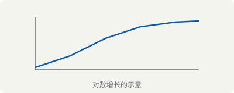

## Matrices and vectors

A product of two matrices, and a column vector:

$$
A = \begin{pmatrix} 1 & 2 \\ 3 & 4 \end{pmatrix}, \qquad
\vec{v} = \begin{pmatrix} 1 \\ 2 \\ 3 \end{pmatrix}
$$

Written elementwise:

$$
(AB)_{ij} = \sum_{k=1}^{n} a_{ik} b_{kj}
$$

## Determinants

$$
\det A = \begin{vmatrix} a & b \\ c & d \end{vmatrix} = ad - bc
$$

The Vandermonde determinant — deliberately wide, to exercise horizontal scrolling on narrow screens:

$$
\begin{pmatrix} 1 & x_1 & \cdots & x_1^{n-1} \\ 1 & x_2 & \cdots & x_2^{n-1} \\ \vdots & \vdots & \ddots & \vdots \\ 1 & x_n & \cdots & x_n^{n-1} \end{pmatrix}
= \prod_{1 \leq i < j \leq n} (x_j - x_i)
$$

## Piecewise definitions and limits

$$
f(x) = \begin{cases}
  x^2 & \text{if } x \geq 0 \\
  -x  & \text{otherwise}
\end{cases}
$$

$$
\lim_{n \to \infty} \left(1 + \frac{1}{n}\right)^n = e
$$

## Inline math

The complexity $\mathcal{O}(n \log n)$ beats $\mathcal{O}(n^2)$. The Euclidean norm of $\vec{v}$ is written $\|\vec{v}\|_2$, and the positive reals are $\mathbb{R}_{>0}$.

Note how inline math sits on the baseline without disturbing the leading of the surrounding paragraph, even when the expression is tall like $\frac{a+b}{c+d}$.

## Code blocks

Plain, unhighlighted:

```
plain text, no highlighting
```

C:

```c
#include <stdio.h>

int main(void) {
    char *s = "hello";
    printf("%s\n", s);   // comment
    return 0;
}
```

Rust:

```rust
fn gcd(a: u64, b: u64) -> u64 {
    if b == 0 { a } else { gcd(b, a % b) }
}
```

Shell:

```bash
find . -name '*.md' -exec pandoc -t html {} \;
```

Python:

```python
from pathlib import Path

posts = sorted(Path("src/posts").glob("*.md"))
for p in posts:
    print(p.stem, p.stat().st_size)
```

## Tables

| Symbol | Meaning | Example |
|--------|---------|---------|
| $\det$ | determinant | $\det A$ |
| $\sum$ | summation | $\sum_{i=1}^n i$ |
| $\prod$ | product | $\prod_{i=1}^n x_i$ |

## Lists and quotations

- First item
  - Nested item
- Second item

1. Ordered item
2. Another item

> A quotation, the sort of thing used to set off a problem statement or someone else's words.

## Task lists

- [x] Verify matrix rendering
- [x] Check dark mode
- [ ] Confirm horizontal scrolling on mobile
- [ ] Decide whether to self-host a math font

## Margin notes

MathML has rendered natively in Chromium since version 109[^chrome], and reached Baseline "widely available" in July 2025[^baseline]. That is what makes the no-JavaScript approach viable rather than merely aspirational.

[^chrome]: Chrome 109 shipped in January 2023, which is when MathML Core became usable in the majority browser.

[^baseline]: Baseline status means every current version of the major browsers supports the feature.

## Images


